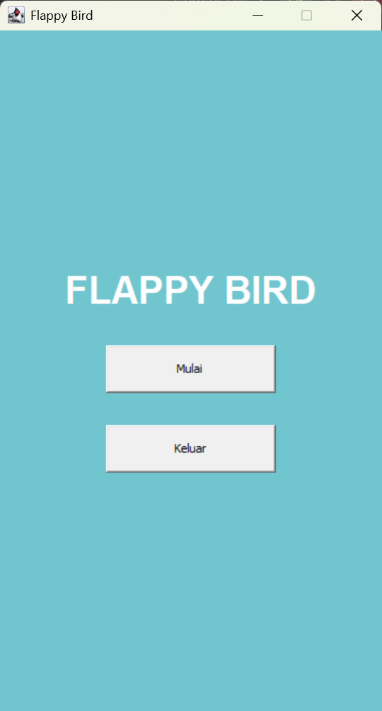
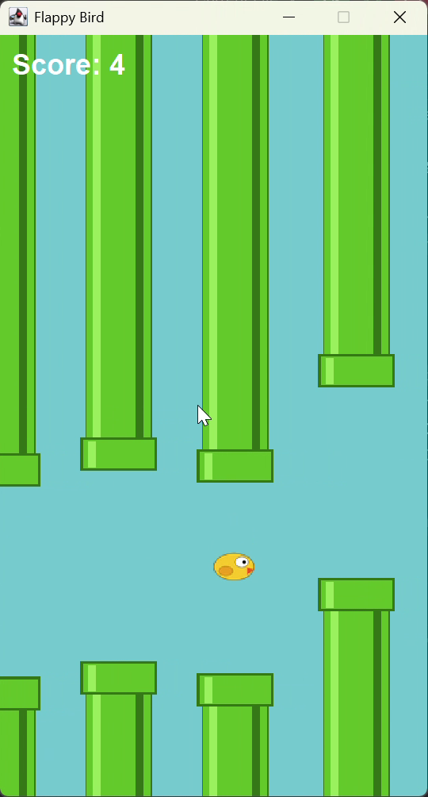
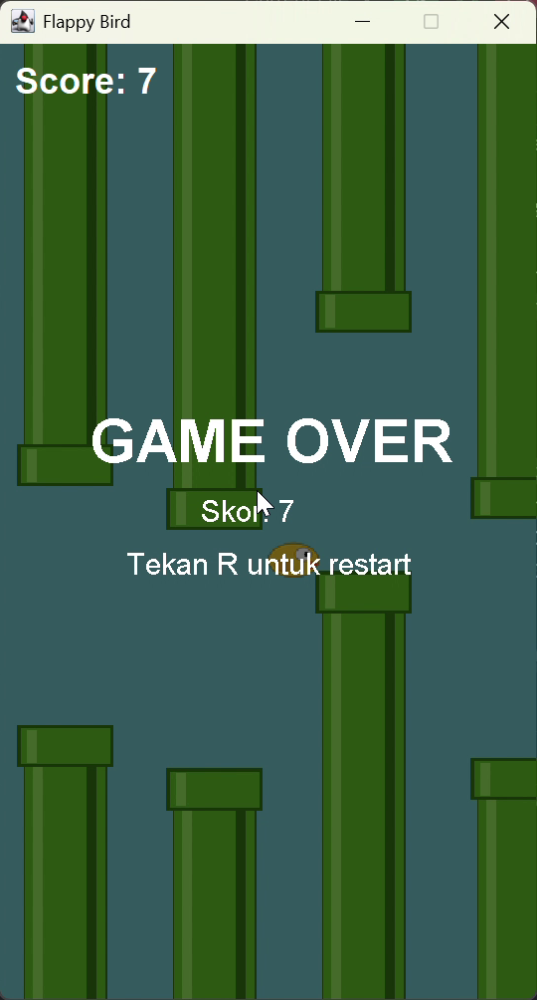
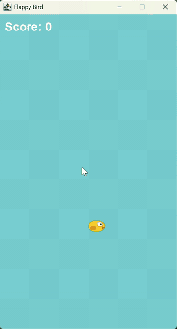

# Flappy Bird - TP 6 DPBO (Java Swing)

**Nama :** Najib Nurohman  
**NIM :** 2509653  

## 📜 JANJI
> Saya **Najib Nurohman** dengan NIM **2509653** mengerjakan **Tugas Praktikum 6** dalam mata kuliah **Desain Pemrograman Berorientasi Objek (DPBO)** untuk keberkahan-Nya maka saya tidak akan melakukan kecurangan seperti yang telah dispesifikasikan. Aamiin.

---

## Desain Program

Program memakai pola sederhana **Model - View - Logic**, dengan satu `JFrame` yang berisi dua layar (`CardLayout`): menu dan game.

| Kelas | Peran |
|---|---|
| `App` | Entry point. Membuat `JFrame`, `Logic`, `View`, dan `MainMenu`, lalu mengatur perpindahan layar menu ke game. |
| `MainMenu` | Layar awal berisi judul dan 2 tombol: **Mulai** dan **Keluar**. |
| `Player` | Model burung: posisi (`posX`, `posY`), ukuran, gambar, dan `velocityY`. |
| `Pipe` | Model pipa: posisi, ukuran, gambar, `velocityX`, dan flag `passed` (sudah dilewati atau belum). |
| `Logic` | Otak game: `Timer` game loop (60 FPS), `Timer` pembuat pipa (1,5 detik), gravitasi, pergerakan, deteksi tabrakan, skor, input keyboard, dan audio. |
| `View` | `JPanel` kanvas. Menggambar pipa, player, overlay Game Over, dan memiliki `JLabel` skor. |
| `Sound` | Helper audio (`Clip`) untuk BGM dan sound effect. |

### Atribut penting `Logic`
- `gravity = 1`, `jumpPower = -9`, `pipeVelocityX = -2`
- `pipes` : `ArrayList<Pipe>`, pipa atas dan bawah selalu ditambahkan berpasangan (indeks genap = atas, ganjil = bawah)
- `score`, `gameOver`

## Penjelasan Alur

1. **Program dijalankan.** `App.main` menampilkan `MainMenu`.
2. **Tombol Mulai** menampilkan layar game dan memanggil `Logic.startGame()`. Fungsi ini mereset posisi player, mengosongkan list pipa, mengatur skor ke 0, menjalankan kedua timer, dan memutar BGM. **Tombol Keluar** memanggil `System.exit(0)`.
3. **Pipa dibuat** setiap 1,5 detik oleh `pipesCooldown` lewat `placePipes()`. Posisi celah ditentukan acak dengan `Math.random()`, dan jarak celah tetap `frameHeight / 4`.
4. **Game loop** (`actionPerformed`, 60 kali per detik) menjalankan berurutan:
   1. `move()`: gravitasi menambah `velocityY` player, posisi player dan semua pipa diperbarui.
   2. Deteksi **tabrakan**: `Rectangle.intersects` antara player dan tiap pipa, serta cek apakah player menyentuh batas bawah frame. Jika ya, `endGame()` dipanggil.
   3. Hitung **skor**: jika `posX` player melewati sisi kanan pipa atas yang belum `passed`, skor +1 (sekali per pasangan pipa), label skor diperbarui, dan sound effect diputar.
   4. Pipa yang sudah keluar dari layar sebelah kiri dihapus (sepasang sekaligus).
   5. `repaint()` untuk menggambar ulang.
5. **Input keyboard**: `SPACE` membuat burung melompat (`velocityY = jumpPower`). `R` hanya berfungsi saat Game Over dan memanggil `startGame()` untuk restart.
6. **Game Over** (`endGame()`): kedua timer dihentikan, BGM berhenti, sound effect tabrakan diputar, dan `View` menampilkan overlay "GAME OVER" beserta skor akhir dan petunjuk menekan R.

### Audio (Bonus)
Memakai `javax.sound.sampled` (format WAV) dari folder `src/assets`:
- `bgm.wav` : musik latar, diputar berulang selama game berjalan
- `jump.wav` : saat burung melompat
- `point.wav` : saat skor bertambah
- `hit.wav` : saat Game Over

## Cara Menjalankan

```bash
cd src
javac App.java
java App
```

Atau buka folder proyek di IntelliJ IDEA, lalu jalankan `App.java`. Pastikan folder `assets` berada di sebelah `App.java` (di dalam `src`).

## Dokumentasi Program Dijalankan

Berikut adalah dokumentasi tampilan dan alur permainan Flappy Bird:

### 1. Main Menu
Tampilan layar awal sebelum permainan dimulai dengan tombol **Mulai** dan **Keluar**.



### 2. Gameplay
Tampilan saat permainan sedang berjalan, burung melompati celah pipa, dan skor bertambah.



### 3. Game Over
Tampilan ketika burung menabrak pipa atau menyentuh batas bawah layar, disertai skor akhir dan instruksi menekan tombol `R` untuk restart.



### 4. Animasi Gameplay (GIF) & Demo
Demonstrasi rekaman alur permainan dari awal hingga Game Over:



> File rekaman video asli (.mp4) tersimpan di [`Dokumentasi/demo.mp4`](Dokumentasi/demo.mp4).
